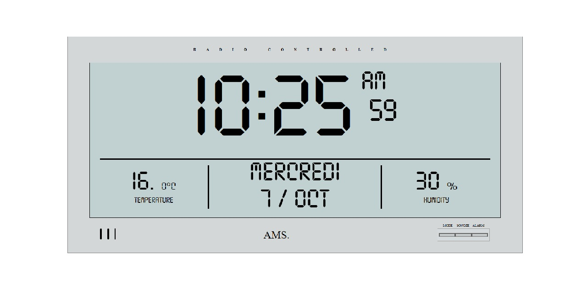

  

## Objectif du projet

Ce projet d'intégration m'a permis de pratiquer le JavaScript natif (Vanilla JS) et de consolider mes bases en intégration sans framework.

### Réalisations techniques

- Manipulation du DOM.
- Interface fluide adaptée aux différents formats d'écrans.
